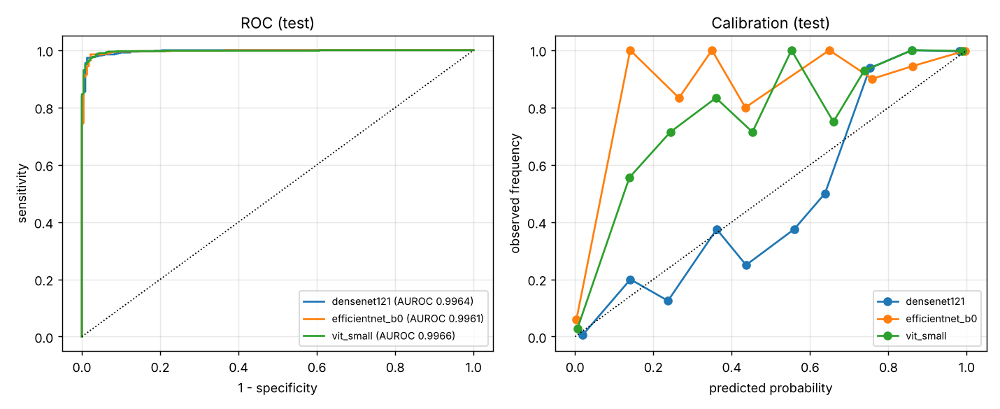

# Pneumonia-X — détection de pneumonie sur radiographies thoraciques

Projet de bout en bout : données auditées et découpées par patient, comparaison d'architectures
(PyTorch Lightning), suivi MLflow, évaluation clinique (rappel, seuil), validation externe,
explicabilité vérifiée et mise en service (FastAPI, Docker, ONNX, démo Gradio).

## Étape 1 — Données (fait)

Jeu de données : [Kermany — Chest X-Ray Images (Pneumonia)](https://www.kaggle.com/datasets/paultimothymooney/chest-xray-pneumonia).

Le découpage d'origine de Kaggle pose deux problèmes connus : un ensemble de validation de 16 images
seulement, et aucune garantie qu'un même patient ne soit pas à la fois en entraînement et en test.
`scripts/prepare_data.py` :

1. indexe chaque image (étiquette, sous-type bactérien/viral, identifiant patient tiré du nom de fichier, empreinte MD5) ;
2. **mesure les fuites du découpage d'origine** (patients et images identiques partagés entre train/val/test) ;
3. retire les doublons exacts ;
4. construit un **nouveau découpage 70/15/15 par patient**, stratifié sur l'étiquette (`StratifiedGroupKFold`, graine fixe), et vérifie qu'aucun patient ni aucune image n'apparaît dans deux ensembles.

```bash
pip install -r requirements-dev.txt
python scripts/prepare_data.py --download      # ou --data-dir <dossier contenant chest_xray/>
python scripts/audit_patient_ids.py             # vérifie les identifiants patients partagés
pytest -q
```

Sorties dans `data/splits/` : `split.csv` (versionné), `report.md` et `report.json` (chiffres de l'audit), `index.csv`, `duplicates.csv`.

## Étape 2 — Entraînement (PyTorch Lightning, Hydra, MLflow)

- `src/pneumonia/train.py` : n'importe quel backbone `timm` avec une sortie unique, perte pondérée
  selon le déséquilibre des classes (calculée sur le train), augmentations sans retournement
  horizontal (le côté du cœur compte sur une radio), arrêt anticipé et meilleur checkpoint sur l'AUC
  de validation.
- Configuration Hydra (`configs/`) : une configuration par modèle — EfficientNet-B0, DenseNet121, ViT-Small.
- MLflow (`mlflow.db` + `mlartifacts/`) : hyperparamètres, commit git, empreinte de `split.csv`,
  courbes, métriques de test et prédictions du meilleur modèle sur val et test.
- Test de bout en bout sur CPU (`tests/test_train.py`) exécuté en CI.

```bash
python -m pneumonia.train -m model=efficientnet_b0,densenet121,vit_small data.root=<dossier>
mlflow ui --backend-store-uri sqlite:///mlflow.db
```

Sur GPU Kaggle : `notebooks/kaggle_train.ipynb` (entraîne les 3 modèles, refait la vérification
des identifiants patients avec des embeddings profonds et produit `results.zip`).

## Étape 3 — Évaluation clinique (résultats du 19/11/2026, GPU Kaggle T4)

`scripts/evaluate.py` lit les prédictions sauvegardées (`results/<modèle>/pred_*.csv`) :
seuil choisi **sur la validation uniquement** (sensibilité ≥ 98 %) puis appliqué une fois au test,
intervalles de confiance à 95 % par **bootstrap sur les patients**, comparaison appariée des AUROC,
calibration (Brier, ECE), sensibilité par sous-type (bactérienne / virale), liste des erreurs.
Rapport complet : [`results/evaluation.md`](results/evaluation.md).

Test : 832 images, 397 patients (enfants, jeu de Kermany).

| modèle | AUROC [IC 95 %] | sensibilité | spécificité | pneumonies manquées | fausses alertes |
|---|---|---|---|---|---|
| DenseNet121 | 0,9964 [0,9937 ; 0,9986] | 97,9 % | 96,5 % | 13 | 8 |
| EfficientNet-B0 | 0,9961 [0,9927 ; 0,9987] | 98,3 % | 97,8 % | 10 | 5 |
| ViT-Small | 0,9966 [0,9938 ; 0,9989] | 98,2 % | 96,5 % | 11 | 8 |

- Les écarts d'AUROC entre modèles ne sont **pas significatifs** (tous les IC de différence contiennent 0).
- Les 4 pneumonies manquées par les 3 modèles sont **virales** ; les 3 fausses alertes communes sont des radios « NORMAL2 ».
- Limite : évaluation interne sur des enfants d'un seul centre ; la validation externe (étape 4) dira si le modèle généralise.



## Feuille de route

- [x] Étape 1 — audit des données et découpage par patient
- [x] Étape 2 — entraînement PyTorch Lightning + Hydra, comparaison EfficientNet / DenseNet121 / ViT, suivi MLflow
- [x] Étape 3 — évaluation clinique : AUC, rappel, choix du seuil, intervalles de confiance
- [ ] Étape 4 — validation externe sur RSNA Pneumonia Detection Challenge
- [ ] Étape 5 — Grad-CAM confronté aux boîtes annotées par des radiologues (RSNA)
- [ ] Étape 6 — API FastAPI, Docker, export ONNX (latence CPU), démo Gradio sur Hugging Face Spaces

> Projet à visée pédagogique et de démonstration, pas un dispositif médical.
