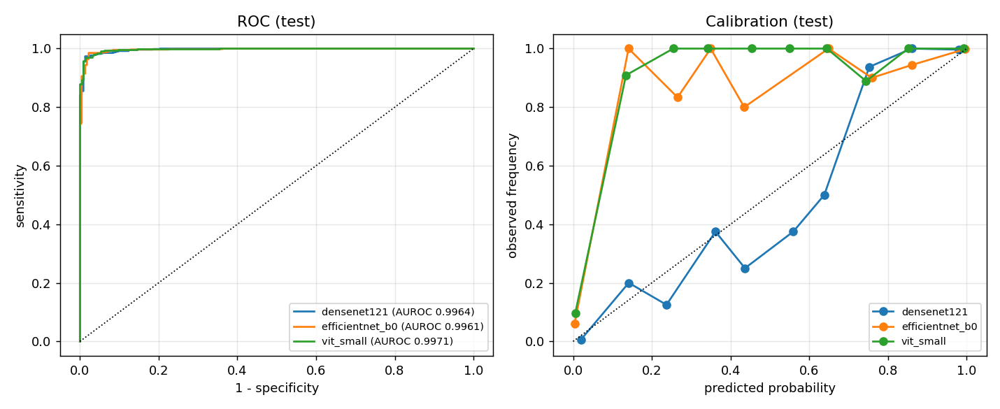

# Step 3 — Clinical evaluation

Test set: 832 images, 397 patients. Thresholds chosen on validation only. 95 % CI: patient bootstrap, n = 2000.

## Threshold-free metrics (test)

| model | AUROC [95 % CI] | AUPRC | Brier | ECE |
|---|---|---|---|---|
| densenet121 | 0.9964 [0.9937 ; 0.9986] | 0.9987 | 0.0205 | 0.0296 |
| efficientnet_b0 | 0.9961 [0.9927 ; 0.9987] | 0.9985 | 0.0367 | 0.0448 |
| vit_small | 0.9971 [0.9948 ; 0.9989] | 0.9989 | 0.0511 | 0.0682 |

## Paired AUROC differences (test, same bootstrap patients)

- densenet121 - efficientnet_b0: +0.0003 [-0.0015 ; +0.0023] → not significant (CI contains 0)
- densenet121 - vit_small: -0.0006 [-0.0021 ; +0.0008] → not significant (CI contains 0)
- efficientnet_b0 - vit_small: -0.0010 [-0.0029 ; +0.0006] → not significant (CI contains 0)

## Operating point: threshold set on validation for sensitivity ≥ 98%, applied to test

| model | threshold | sensitivity [95 % CI] | specificity [95 % CI] | PPV | NPV | missed pneumonias (FN) | false alarms (FP) |
|---|---|---|---|---|---|---|---|
| densenet121 | 0.6094 | 97.9 % [96.6 % ; 99.0 %] | 96.5 % [94.0 % ; 98.7 %] | 98.7 % | 94.4 % | 13 | 8 |
| efficientnet_b0 | 0.0590 | 98.3 % [97.3 % ; 99.3 %] | 97.8 % [95.7 % ; 99.6 %] | 99.2 % | 95.7 % | 10 | 5 |
| vit_small | 0.0333 | 97.9 % [96.5 % ; 99.0 %] | 96.5 % [94.0 % ; 98.6 %] | 98.7 % | 94.4 % | 13 | 8 |

## For reference: Youden threshold (val) and default 0.5

| model | Youden threshold | sensitivity | specificity | sens. @0.5 | spec. @0.5 |
|---|---|---|---|---|---|
| densenet121 | 0.7378 | 96.2 % | 98.7 % | 98.3 % | 94.2 % |
| efficientnet_b0 | 0.1312 | 97.0 % | 97.8 % | 93.7 % | 98.7 % |
| vit_small | 0.1086 | 95.7 % | 98.7 % | 91.3 % | 99.1 % |

## Sensitivity by pneumonia subtype (test, operating threshold)

| model | bacterial | viral |
|---|---|---|
| densenet121 | 99.0 % (n = 399) | 95.7 % (n = 207) |
| efficientnet_b0 | 99.0 % (n = 399) | 97.1 % (n = 207) |
| vit_small | 99.0 % (n = 399) | 95.7 % (n = 207) |

Errors per model: `errors_<model>.csv` (to inspect visually).

