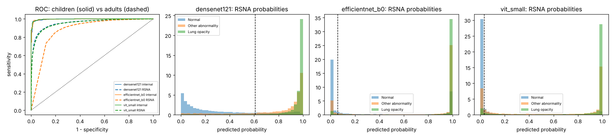

# Step 4 — External validation on RSNA (adults) vs internal test (children)

RSNA images: 26684 (rsna_not_normal: 11821, rsna_normal: 8851, rsna_opacity: 6012). Main task = Lung Opacity vs Normal (14863 images). 95 % CI: bootstrap, n = 1000 (one image per patient).

## Discrimination

| model | AUROC internal (children) | AUROC RSNA opacity vs normal [95 % CI] | AUROC RSNA all images | Brier RSNA | ECE RSNA |
|---|---|---|---|---|---|
| densenet121 | 0.9964 | 0.9565 [0.9531 ; 0.9596] | 0.8291 | 0.1309 | 0.1637 |
| efficientnet_b0 | 0.9961 | 0.8791 [0.8742 ; 0.8842] | 0.7479 | 0.1990 | 0.1963 |
| vit_small | 0.9971 | 0.9537 [0.9503 ; 0.9567] | 0.8239 | 0.0860 | 0.0653 |

## Operating threshold chosen on internal validation (sensitivity ≥ 98%)

| model | threshold | internal sens. / spec. | RSNA sens. / spec. | false alarms on other abnormalities |
|---|---|---|---|---|
| densenet121 | 0.6094 | 97.9 % / 96.5 % | 94.8 % / 78.0 % | 78.4 % |
| efficientnet_b0 | 0.0590 | 98.3 % / 97.8 % | 95.9 % / 54.8 % | 84.7 % |
| vit_small | 0.0333 | 97.9 % / 96.5 % | 94.5 % / 77.9 % | 77.2 % |

## What does the model really detect? (AUROC between RSNA classes)

| model | opacity vs normal | other abnormality vs normal | opacity vs other abnormality |
|---|---|---|---|
| densenet121 | 0.9565 | 0.8603 | 0.7337 |
| efficientnet_b0 | 0.8791 | 0.7758 | 0.6496 |
| vit_small | 0.9537 | 0.8529 | 0.7267 |

## Local recalibration: Youden threshold set on 20 % of RSNA, evaluated on 80 %

| model | internal threshold | sens. / spec. | local threshold | sens. / spec. |
|---|---|---|---|---|
| densenet121 | 0.6094 | 95.0 % / 78.1 % | 0.8481 | 88.9 % / 90.5 % |
| efficientnet_b0 | 0.0590 | 95.8 % / 54.8 % | 0.9854 | 85.1 % / 80.1 % |
| vit_small | 0.0333 | 94.5 % / 78.2 % | 0.4341 | 87.4 % / 91.2 % |

